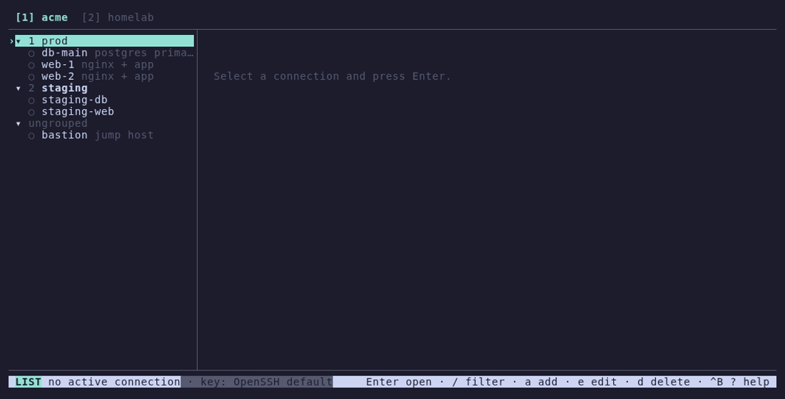

# sshctl

An SSH workspace: keep sessions open in tabs and each customer's hosts in their own Space.

> [!WARNING]
> sshctl is in early development (0.x). Some features are new and not fully tested, so expect bugs and breaking changes between releases, and do not rely on it in production. Back up `~/.ssh/config` and `~/.config/sshctl/` before you start.

`sshctl` is a cross-platform Go CLI for managing connection metadata while delegating SSH work to your installed OpenSSH tools. It never stores private keys or passphrases.



## Feature status

| Feature | Status |
| --- | --- |
| Connections, Spaces, Groups, keys, known hosts, config, the Workspace | Stable |
| [Bootstrap](docs/guide.md#bootstrap) | Experimental, off until turned on ([Experimental features](docs/guide.md#experimental-features)) |
| [Provision](docs/guide.md#provision) | Experimental, off until turned on ([Experimental features](docs/guide.md#experimental-features)) |
| [Syncing with chezmoi](docs/guide.md#syncing-with-chezmoi) | Not fully tested: sshctl has no sync command, so there is nothing to turn on, but the documented setups are new |

## Quick start

On Linux (amd64 or arm64), with the OpenSSH client and `curl` installed, install sshctl to `/usr/local/bin` (the script uses `sudo`):

```sh
curl -fsSL https://raw.githubusercontent.com/jackykornet/sshctl/main/install.sh | bash
```

Prefer to read it first? Download the script, look at it, then run it:

```sh
curl -fsSL -o install.sh https://raw.githubusercontent.com/jackykornet/sshctl/main/install.sh
less install.sh
bash install.sh
```

Then open the Workspace, which lists the hosts in your `~/.ssh/config`:

```sh
sshctl
```

or connect to one of them straight away with `sshctl <alias>`.

On macOS, Windows, Alpine, or to build from source, follow [Install](docs/install.md).

## Documentation

- [Install](docs/install.md): the packages to install first, `install.sh` or a manual download, and uninstalling, for each Linux distribution, macOS and Windows, and the supported systems.
- [Guide](docs/guide.md): every command, the Workspace and its keys, configuration and security, and syncing your Connections with chezmoi.

## Development

Run the checks CI runs from the repository root:

```sh
gofmt -l .
go vet ./...
GOOS=windows go vet ./...
go test -race ./...
```

`gofmt -l .` must print nothing. CI does not cross-vet, so run the Windows `go vet` yourself. After an intended change to the Workspace layout, regenerate its golden files with `go test ./internal/workspace -update` and review the diff.

The Workspace GIFs (the one at the top of this README and those in the [Guide](docs/guide.md)) are recorded with [vhs](https://github.com/charmbracelet/vhs), which needs `ttyd`, `ffmpeg` and Chromium (the dev container installs all four). Each `docs/demo/<name>.tape` records `docs/demo/<name>.gif`. When the layout changes, re-record them from the repository root and check the results:

```sh
for t in docs/demo/*.tape; do vhs "$t"; done
```

Every tape starts with `docs/demo/sandbox/start.tape`, which builds sshctl and runs it with `HOME` set to a copy of `docs/demo/sandbox/home`, which holds made-up hosts only, and with `docs/demo/sandbox/bin/ssh` in place of OpenSSH, a script that plays a remote shell and connects nowhere. Keep any new demo data made up.

CI runs `gofmt` on Ubuntu, and `go vet` and the test suite on the GitHub-hosted Ubuntu, macOS, and Windows runners (Linux and Windows on amd64, macOS on arm64). The other three targets are only cross-compiled. The Workspace's Session tests start real processes in pseudo-terminals on all three runners, with `sh` (or `cmd.exe` on Windows, through ConPTY) standing in for `ssh`. A few Session tests rely on POSIX-only tools and are skipped on Windows.

CI does not run a real OpenSSH client or open terminal windows, so actual connections and `group connect`'s terminal launching depend on the locally installed OpenSSH and terminal applications and are not verified by CI.

A release is a milestone titled with its version tag (`v0.7.0`). When the milestone has no open issues left and CI has passed on `main`, the **Milestone release** workflow tags `main` and runs the **Release** workflow, which builds the Windows, macOS and Linux binaries for amd64 and arm64 and publishes them. To publish an existing tag by hand, run the **Release** workflow from GitHub Actions and enter the tag (for example, `v0.1.0`). New `v*` tags publish automatically.
