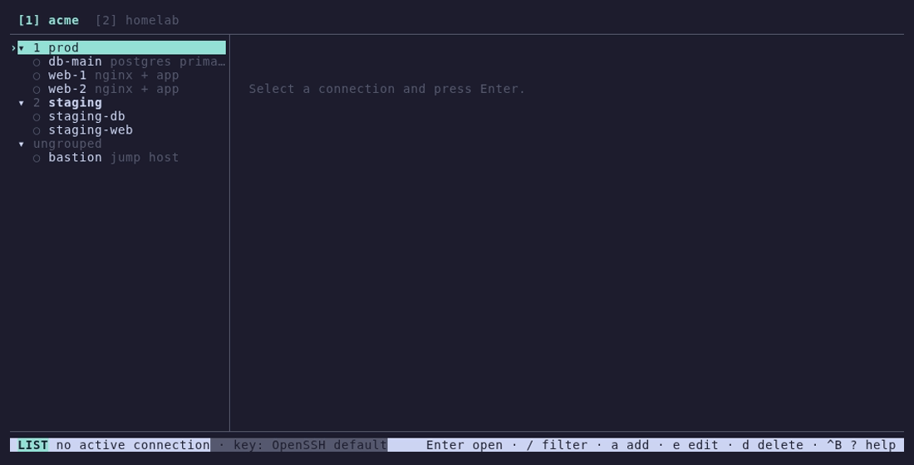

# sshctl Guide

How to use sshctl once it is installed. To install it, see [Install](install.md); for an overview, the [README](../README.md).

- [Commands](#commands)
  - [JSON output for scripts](#json-output-for-scripts)
  - [Experimental features](#experimental-features)
  - [Bootstrap](#bootstrap)
  - [Provision](#provision)
- [Shell completion](#shell-completion)
- [Workspace](#workspace)
  - [Spaces](#spaces)
  - [Keys in the Workspace](#keys-in-the-workspace)
  - [Tunnels in the Workspace](#tunnels-in-the-workspace)
  - [Adding, editing and deleting connections](#adding-editing-and-deleting-connections)
  - [Groups](#groups)
  - [Mouse and settings](#mouse-and-settings)
  - [Copying from vim](#copying-from-vim)
- [Configuration and security](#configuration-and-security)
- [Syncing with chezmoi](#syncing-with-chezmoi)
  - [Recommended: a private repo with symlinks](#recommended-a-private-repo-with-symlinks)
  - [Setting up a new machine](#setting-up-a-new-machine)
  - [Alternative: encrypted in your public dotfiles repo](#alternative-encrypted-in-your-public-dotfiles-repo)

## Commands

```text
sshctl
sshctl [-c] <alias> [-- <command>...]
sshctl list [--space <space>] [--json]
sshctl info <alias> [--json]
sshctl tunnel add <alias> <spec>
sshctl tunnel rm <alias> <name|port>
sshctl tunnel list [<alias>]
sshctl tunnel <alias>
sshctl add <alias> [--<field> <value>]...
sshctl edit <alias> [--<field> <value>]...
sshctl remove <alias> [--yes]
sshctl space list [--json]
sshctl space add <name> [<number>]
sshctl space rename <space> <new>
sshctl space delete <space>
sshctl space move <space> <number>
sshctl space color <space> <color|none>
sshctl space dotfiles <space> [<url|none> | --unset]
sshctl group [--space <space>] list [--json]
sshctl group [--space <space>] add <name>
sshctl group [--space <space>] rename <group> <new>
sshctl group [--space <space>] delete <group> [--yes]
sshctl group [--space <space>] move <group> <position>
sshctl group [--space <space>] connect <group>
sshctl group [--space <space>] color <group> <color|none>
sshctl history
sshctl key list
sshctl key use [--space <space>] <key-path|none>
sshctl key add <private-key-path>
sshctl agent ensure
sshctl known-hosts list
sshctl known-hosts remove <host>
sshctl bootstrap <alias>
sshctl provision <alias>
sshctl provision default [<url|none> | --unset] [--group <name>]
sshctl experimental list
sshctl experimental enable|disable <feature>
sshctl config show
sshctl completion bash|zsh|fish|powershell
```

`sshctl <alias>` connects: it runs `ssh <alias>`. A selected sshctl key adds `-i <path>`; with no override, OpenSSH chooses identities using its normal config and defaults. `sshctl <alias> -- <command>...` runs the command on the host instead, as `ssh <alias> <command>...` does, and sshctl exits with the command's exit code. A first word that is a built-in command is always the command ([ADR-0011](adr/0011-bare-alias-connects.md)): an alias named `list` or `key` is reached with `sshctl -c <alias>` (`--connect`), which scripts should use, since a later sshctl may add a command with the name of your alias. `list` marks such an alias with `(sshctl -c <alias>)`, and the Workspace's add and edit form warns about it. A bare word that is neither a command nor a Connection is refused, so a mistyped command is not sent to ssh; `-c` connects to any name ssh accepts.

Options follow the GNU convention on every OS: `--name value` or `--name=value`, anywhere after the command name (`sshctl group list --space acme` and `sshctl group --space acme list` are the same), and `--` ends the options. `-c`, `-s`, `-g`, `-y` and `-h` stand for `--connect`, `--space`, `--group`, `--yes` and `--help`; every other option is long only. `sshctl --version` prints the version.

Aliases come from `~/.ssh/config` and any files it pulls in with `Include` (wildcard `Host` patterns are skipped); a Connection's description and group are sshctl metadata only. `list` shows the same Connections as the Workspace: the ssh_config aliases in ssh_config order, then Orphaned connections (metadata whose alias is no longer in ssh_config) sorted by alias and marked `(missing)`. `add` and `edit` set the same fields as the Workspace's add/edit form except Tunnels, which `sshctl tunnel` sets and `edit` keeps, and save them the same way: the Host block (HostName, User, Port, Identity file) goes to `~/.ssh/sshctl_config`, and the description, Space and group are sshctl metadata.

```sh
sshctl add web01 --host 203.0.113.10 --user deploy --port 2222 --identity ~/.ssh/id_ed25519 \
    --group web --space work --description "public site"
sshctl edit web01 --port 22
sshctl edit web01 --alias web02
```

`add` creates a new Connection, and refuses an alias that already exists anywhere in ssh_config; `edit` changes an existing one, and `--alias` renames it. With flags, only the fields given change (`--user ""` clears one); without flags, both prompt for each field in turn and an empty answer keeps the current value. `--space` and `--group` take a name or number as everywhere else, and `--group 0` is ungrouped; a Space change without `--group` leaves the Connection ungrouped. The group must already exist: an unknown one is refused with the `sshctl group add` command that creates it. An invalid value (a port outside 1-65535, a hostname with spaces) is refused and nothing is written. For a Connection whose Host block is your own, `edit` changes only its description, Space and group, says so, and refuses Host fields. The first time sshctl writes a Host block it asks to add `Include sshctl_config` to your `~/.ssh/config`, as the Workspace does. `remove` does what the Workspace's delete does: it deletes the Host block if sshctl wrote it and the sshctl metadata, its Tunnels included, after asking (`--yes` skips the question); a Host block in your own ssh_config stays. A Connection with neither description, Space, group nor Tunnels keeps no metadata.

A Tunnel is a saved SSH local forward on a Connection, for reaching a service the server does not expose publicly, such as an admin web UI. `tunnel add <alias> <spec>` saves one, written `[name=]localport[:host:remoteport]`: `8083` forwards `localhost:8083` on your machine to port 8083 on the server itself, and `panel=8080:10.0.0.5:80` is a named Tunnel to another host the server can reach. A Connection's local ports and names must differ, a name may not be only digits, and ports run from 1 to 65535. `tunnel <alias>` runs all of the Connection's Tunnels in your terminal as one `ssh -N -L … <alias>` with the same key as `sshctl <alias>`, prints a `http://localhost:<port>` line for each, and stops on Ctrl-C; ssh may prompt, and sshctl exits with ssh's exit status. `tunnel rm <alias> <name|port>` deletes one, and `tunnel list [<alias>]` lists them. Tunnels are stored in `config.json`, so they sync and follow a renamed Connection; the Host block is never changed (ADR-0012).

`key list` lists public keys and certificates found in `~/.ssh` and registered external key paths. `key add` registers a key path; `key use` selects the identity used by sshctl. `agent ensure` inspects `ssh-add -l` and asks before adding the selected key. It does not start an agent automatically, and does not perform a signing challenge to inspect loaded keys. On Windows, use the OpenSSH Authentication Agent service and start it yourself if unavailable; normal connections do not require elevation.

`known-hosts remove` asks before invoking `ssh-keygen -R`, which handles hashed entries. `known-hosts list` displays the host field as stored (hashed names remain hashed).

Groups exist from `group add` until `group delete`, even with no Connections, and are listed in the order you set. `group list` shows each Group's number (its position, counting from 1, as in the Workspace headers), name, member count and dotfiles repo for Provision (`unset` when the global default applies). `group rename` moves every Connection with the Group and keeps its position and collapsed state; it refuses a name another Group has. A group name may not be only digits, since numbers stand for positions. `group delete` asks `Delete group X? N Connections become ungrouped.` first (`--yes` skips the question); it never deletes a Connection or a Host block. `group move <group> <position>` puts the Group at that position, shifting the others. `group color <group> <color>` gives the Group an [Indicator color](#indicator-colors) and `group color <group> none` clears it; `group list` ends a coloured Group's line with `color red`. Where a command takes a `<group>`, it can also be the Group's number, but a name keeps working in scripts when Groups are reordered. `0` stands for ungrouped, as in the Workspace: `group connect 0` opens the Space's ungrouped Connections, and `rename`, `delete` and `move` refuse it, since ungrouped is not a Group. An unknown name or number is refused with the Groups the Space has.

Spaces keep Connections apart, for example one per customer or project. Every Group and Connection belongs to one Space; the default Space holds everything not put elsewhere. Each Space has a Space number from 1 to 9, which it keeps until you move it, so there are at most nine Spaces. `space add <name>` gives the new Space the lowest free number, and `space add <name> <number>` that number; a taken number, or a tenth Space, is refused. `space list` shows each Space's number, name, Group count and Connection count in number order, and marks the default Space; free numbers leave gaps (`1`, `2`, `4`), and a Space without a number (beyond the ninth in an older config) comes last, shown as `-`. `space rename` keeps the Space's Groups, Connections and number; the default Space can be renamed and stays the default. `space delete` deletes only an empty Space, and refuses the default Space; otherwise it names the Groups and Connections left in it. Its number becomes free, and no other Space renumbers. `space move <space> <number>` gives the Space that number, swapping with the Space that has it. `space color <space> <color|none>` sets or clears the Space's [Indicator color](#indicator-colors), which `space list` shows as `color blue`. Where a command takes a `<space>`, it is a Space name or number (`space rename 4 acme`); a name or number no Space has is refused, naming the Spaces there are (`no Space 3; the Spaces are 1 home, 2 acme`). A Space name may not be empty, only digits, or contain `/`. Spaces are sshctl metadata only: aliases stay one namespace, so `sshctl <alias>` needs no Space.

`list --space <space>` lists only that Space's Connections; like every `--space`, it takes a Space name or number (`--space 4`). `group` commands take `--space <space>` to pick the Space; `group add` without it adds to the default Space, and `group list` without it lists every Space's Groups, each line starting with the Space's name when there are several. Without `--space`, a Group name is looked up in every Space and used when exactly one Space has it; when several do, sshctl names them and asks for `--space`. A Group number (`0` included) counts within a Space, so it works without `--space` only while there is one Space.

`group connect <group>` opens one OS terminal window per Connection in the Group, each connecting with ssh. To open a Group's Connections as tabs instead, use prefix `g` in the [Workspace](#workspace). For terminal windows, sshctl supports Windows Terminal (or `cmd start` fallback), macOS Terminal, and Linux GNOME Terminal, Konsole, Xfce Terminal, or `x-terminal-emulator`. Availability depends on the host's installed terminal; the command reports an actionable error when none is found.

### JSON output for scripts

`list --json`, `group list --json` and `space list --json` print a JSON array of objects, and `info <alias>` prints one Connection as a JSON object (JSON is its only form for now; `--json` is accepted, so scripts can pass it and keep working if a text form is added). `--json` has no short form. The field names below are a compatibility promise: they will not be renamed or removed, though fields may be added. Every field is always present; Spaces and Groups are given by name, `""` means none (an empty `group` is ungrouped), and `dotfiles` is the stored repo URL, `"none"` when Provision is refused, or `""` when unset. A list with nothing to show is `[]`. `info` on an alias that is no Connection prints an error on stderr and exits non-zero.

| Command | Fields |
| --- | --- |
| `list --json` | `alias`, `description`, `space`, `group`, `orphaned` (an Orphaned connection, shown as `(missing)`), `shadowedByCommand` (the alias is a built-in command name, reached with `sshctl -c`) |
| `group list --json` | `space`, `number` (its position in the Space, from 1), `name`, `connections` (Orphaned ones included), `dotfiles`, `color` (its own [Indicator color](#indicator-colors), or `""`) |
| `space list --json` | `number` (`null` for a Space without one), `name`, `default`, `groups`, `connections` (Orphaned ones included), `color` (its [Indicator color](#indicator-colors), or `""`), `dotfiles`, `identity` (the Space's own Selected identity, a key path, or `""`) |
| `info <alias>` | `alias`, `space`, `group`, `description`, `managed` (its Host block is in `~/.ssh/sshctl_config`), `orphaned`, `identity` (the Selected identity `sshctl <alias>` uses: its Space's, else the global one, or `""` when OpenSSH chooses keys) |

```sh
sshctl list --json | jq -r '.[] | select(.space == "acme") | .alias'
```

### Experimental features

Bootstrap and Provision are not fully tested yet, so they start off. Turn one on before you use it:

```sh
sshctl experimental enable bootstrap
sshctl experimental enable provision
sshctl experimental list
bootstrap  on
provision  on
```

While a feature is off, its commands (`bootstrap`; `provision`, `provision default` and `space dotfiles`) and its Workspace keys refuse with `Bootstrap is experimental and off. Turn it on with: sshctl experimental enable bootstrap` and change nothing, and the help (`sshctl --help`, the Workspace's `?`) marks it `(experimental, off)`. `sshctl experimental disable <feature>` turns it off again. The setting is `"experimental": { "bootstrap": true, "provision": true }` in `config.json`, so it is synced with the rest of your config and holds on every machine. A running Workspace sees a change after `^B r`.

### Bootstrap

Bootstrap is an [Experimental feature](#experimental-features): turn it on with `sshctl experimental enable bootstrap` first.

`bootstrap <alias>` makes a Connection reachable with your selected key (`sshctl key use`), in your terminal:

1. For a Connection in `sshctl_config`, it writes the HostName, User and Port that `ssh -G <alias>` resolves into its Host block, if they are missing, and clears its `IdentityFile`, so an old key cannot pass the check in step 3.
2. It adds the key's `.pub` to `~/.ssh/authorized_keys` on the host over plain `ssh <alias>` (no `ssh-copy-id`), so you type your password once. A key that is already there is not added again, and `~/.ssh` and the file are made private (700 and 600).
3. It proves that the key alone logs in, with a fresh `ssh` that allows only public-key login with that key: no password or keyboard-interactive login. ssh may ask for the key's passphrase. OpenSSH cannot be told to skip an `IdentityFile` your ssh_config gives the host (for example in `Host *`), so when ssh also offers one, Bootstrap says so.
4. Only then does it set `IdentityFile` in the Host block, written as `~/.ssh/...` when the key is in your home directory.

If step 2 or 3 fails, nothing after step 1 changes, the `IdentityFile` step 1 cleared is put back, and sshctl says why. A host without a POSIX `sh` fails before anything is installed. For a host defined elsewhere in your ssh_config, Bootstrap only installs the key and leaves the Host block as it is. With no selected key, Bootstrap first creates one: `ssh-keygen` makes an ed25519 key at `~/.ssh/id_ed25519`, or at `~/.ssh/sshctl_ed25519` when `id_ed25519` already exists (an existing key is never overwritten), asks you for a passphrase (leave it empty for none), and the new key becomes the selected key. Bootstrap never changes the host's SSH server settings, and never runs Provision. Running it again is safe.

### Provision

Provision is an [Experimental feature](#experimental-features): turn it on with `sshctl experimental enable provision` first.

`provision <alias>` applies your dotfiles to the Connection's host with [chezmoi](https://www.chezmoi.io/), in your terminal over `ssh <alias>` (with the selected key's `-i`). If chezmoi is already on the host (on `PATH` or in `~/.local/bin`), it runs `chezmoi update --apply`. Otherwise it installs chezmoi into `~/.local/bin` with chezmoi's install script, fetched with `curl -fsLS` or, when curl is missing, `wget -qO-`, and runs `init --apply <repo>`; that is the same as running `sh -c "$(curl -fsLS get.chezmoi.io)" -- -b "$HOME/.local/bin" init --apply <repo>` on the host. Provision runs only chezmoi: anything else, such as installing tools with mise, is up to your dotfiles. It never uses sudo and writes only inside the remote home. It never runs on its own and is not part of connecting.

Provision stops before changing anything when the setting is `none`, when the host has no POSIX `sh`, or when it has neither curl nor wget. A failure while applying, such as a tool failing to build, is shown as it happens and sshctl exits with its exit code. The POSIX check is a separate ssh connection, so a host you log in to with a password asks for it twice.

The repo is a setting in sshctl's config, global or per Group. A Connection in a Group whose repo is set uses that Group's repo; otherwise it uses the global one. `none` refuses Provision instead of naming a repo: a Group set to `none` refuses it for its Connections whatever the global setting is. `provision default <url>` sets the global repo, `provision default none` refuses Provision, `provision default --unset` clears the setting, and `--group <name>` does the same for that Group. `provision default` with no arguments shows the global setting and each Group's:

```text
sshctl provision default https://github.com/you/dotfiles.git
sshctl provision default none --group lab
sshctl provision default
global: https://github.com/you/dotfiles.git
group lab: none (Provision refused)
```

The first time you provision with no repo set, sshctl asks for one (`Dotfiles repo URL`), then asks where to keep it: `Save for: (g)lobal, (r) group <name>, (o)nce` (`r` is offered only for a Connection in a Group). `o` uses it this time only. Typing `none` refuses Provision: with `g` or `r` it saves that setting, and with `o` it only stops. With no answer, Provision stops and saves nothing.

## Shell completion

`sshctl completion <shell>` prints a completion script for bash, zsh, fish or PowerShell. It completes commands, subcommands and options, Connection aliases where an alias goes (the first word, after `-c`, and for `add`, `edit`, `remove`, `bootstrap`, `provision` and `tunnel`), Space names after `--space` and Group names after `--group`. The script asks sshctl for the aliases each time, so they are the ones `sshctl list` shows. Enable it in your shell's startup file:

| Shell | Add this |
| --- | --- |
| bash (`~/.bashrc`) | `eval "$(sshctl completion bash)"` |
| zsh (`~/.zshrc`, after `compinit`) | `source <(sshctl completion zsh)` |
| fish | run once: `sshctl completion fish > ~/.config/fish/completions/sshctl.fish` |
| PowerShell (`$PROFILE`) | `sshctl completion powershell \| Out-String \| Invoke-Expression` |

The scripts complete the command named `sshctl` (and `sshctl.exe` in PowerShell); if you renamed the downloaded executable, rename it to `sshctl`.

## Workspace


Run `sshctl` with no arguments in a terminal to open the Workspace: the connection list on the left, the active connection on the right, and a status bar at the bottom. (When output is piped or redirected, `sshctl` prints help instead.)

```
 [1] homelab  [2] customer1  [3] prive
────────────────────────────┬───────────────────────────────────────────
 ▾ 1 web ●1                 │ prod-web · deploy@10.0.0.5:2222
   ● prod-web public site   │  1 ~ │ 2 provision │ +
   ○ staging                │ deploy@prod-web:~$
 ▸ 2 batch 3                │
 ▾ ungrouped                │
   ○ db-main postgres       │
────────────────────────────┴───────────────────────────────────────────
 SESSION web / prod-web  ^B: Tab list · n new · w close · [/] tab · ? help
```

Each row of the list has a dot for its Sessions: green `●` open, yellow `●` when all its tabs have ended, dim `○` not open. Open connections keep their place in the list, and the active connection has a bar across the list. A group header shows its member count only while it is collapsed (`▸`).

Each tab is a Session: an `ssh <alias>` process in its own pseudo-terminal, started with the selected identity at the moment the tab opens. Above the tabs, the pane's header shows the active connection as `alias · user@host[:port]`, as `ssh -G` resolves it (the alias alone if that fails). A tab shows its number and its name: the name you gave it with prefix `,`, else the action's name for a Bootstrap or Provision tab, else `ssh`. A name is cut to 20 columns. A tab with output you have not seen is bold and marked `•`. Click a tab to show it, or `+` for a new tab. A tab whose `ssh` has exited stays open marked `✕` and its exit code, such as `1 ssh ✕ 255`; press `r` to reconnect or `x` to close it. A reconnect keeps the name you gave the tab; it is not saved once the tab closes. Rename with an empty name to go back to `ssh` or the action's name. Quitting with live Sessions asks first and then ends them.

Focus is on the list or on the Session pane; prefix `Tab` moves it (with no Session open it stays on the list and says so). While the list has focus its cursor row is drawn cyan; while the pane has focus the current tab is a cyan block (a plain reverse-video block while the list has focus), and the list keeps a dim `›` where prefix `Tab` will land. The status bar starts with a cyan `LIST` or `SESSION` tag for the focus (left out while a form, prompt or filter shows its own status), then shows the active connection as `group / alias` and the key it uses, and on the right the most important keys where the focus is. The key gives way to them first, then on a narrow terminal the keys go, least important first. While the pane has focus they are all prefix commands, so the prefix is written once: `^B: Tab list · n new · w close`. While a picker, prompt or form is open, the status bar shows only its keys. On a short terminal the rules under the Space bar and above the status bar, then the pane's header, make room for the Session.

Keys go to the remote session. Workspace commands start with the prefix key (`Ctrl+B` by default, as in tmux; press it twice to send it to the session). One rule ([ADR-0007](adr/0007-one-rule-for-workspace-keys.md)) decides where a key works: list actions work bare while the list has focus and after the prefix from anywhere (the table writes these as `/`, prefix `/`); the terminal takes only prefixed commands, except the `r` and `x` of an ended tab; and a key means the same thing everywhere. Hint lines name keys as `key action · key action`, with the prefix shown as `^B`.

| Keys | Action |
| --- | --- |
| `↑`/`↓` (or `k`/`j`), `Enter` | In the list: move, open or switch to a connection |
| `Enter`/`Space`, `←`/`→` (or `h`/`l`) | In the list, on a group header: collapse or expand the group (`←` on a member collapses its group) |
| `Shift+↑`/`Shift+↓` (or `K`/`J`) | In the list, on a group header: move the group up / down; the new order is saved |
| `/`, prefix `/` | Filter the list by alias, description, or group (`Esc` in the list clears it) |
| `[`/`]`, prefix `[`/`]` | Previous / next tab |
| `{`/`}`, prefix `{`/`}` | Previous / next open connection in the active Space |
| `1`–`9`, prefix `1`–`9` | Switch to Space 1–9 |
| `P` / `S`, prefix `P` / `S` | Open the Space picker / show every Space's number and name under the Space bar |
| `I`, prefix `I` | Open the [key picker](#keys-in-the-workspace): choose the Selected identity of new tabs |
| `H`, prefix `H` | Open the History picker: the 20 most recently opened connections from every Space, most recent first. Type to filter by alias, description, group or Space; `Enter` opens the connection or switches to it, making its Space active; a `(missing)` connection does not open; `Esc` closes it |
| `a` / `e` / `d`, prefix `a` / `e` / `d` | Add / edit / delete the connection under the cursor; on a group header, add / rename / delete a group |
| `C`, prefix `C` | Set the [Indicator color](#indicator-colors) of the group under the cursor (from the pane, of the active connection's group); for an ungrouped connection, of its Space |
| `t`, prefix `t` | Start / stop the connection's [Tunnels](#tunnels-in-the-workspace) in the background; with none saved, opens the edit form on its Tunnels field |
| `q` (or `Ctrl+C` in the list), prefix `q` | Quit |
| prefix `n` / `w` | New tab / close tab |
| prefix `,` | Rename the current tab (empty for its automatic name) |
| prefix `i` / `p` | Bootstrap / Provision the connection in its own labelled tab (Provision asks first, and refuses at once when the connection's group is set to `none`); both refuse while the [Experimental feature](#experimental-features) is off |
| prefix `g` | Open every closed connection in the group under the cursor as tabs (`sshctl group connect` instead opens one terminal window per connection) |
| prefix `m` | Move the connection to a group: type a group number, an existing or new group name, or `0` or nothing to remove the connection from its group |
| prefix `Tab` | Move focus between the list and the terminal |
| prefix `s` | Scroll back through the tab's history (`q` to leave; the mouse wheel also scrolls) |
| prefix `b` / `R` | Hide the list / refresh connections from ssh_config |
| prefix `?` | Help (`↑`/`↓` and `PgUp`/`PgDn` scroll it when it does not fit; any other key closes it) |
| `r` / `x` (on an ended tab, or a tunnel row) | Reconnect / close the tab; restart / stop the tunnel |
| `Ctrl+S` / `Ctrl+O` (in the add form) | Save the new connection / save it and Bootstrap it in its own tab (while Bootstrap is off, `Ctrl+O` saves nothing and the form says why) |

### Spaces



The list shows one Space at a time, the active Space: its groups and connections only. Sessions in other Spaces keep running. Each Space has a fixed number from 1 to 9, which it keeps until you change it: deleting a Space leaves its number free, and no other Space is renumbered. With more than one Space, a Space bar across the top shows each Space as `[1] homelab  [2] customer1`: the active Space in the accent colour, a Space with a live session in normal text, an idle one dimmed. When the names do not fit, it shows all nine numbers instead, `[1] [2] [3] … [9]`, a free number fainter still (the gaps close up, `[1][2][3]`, when even that is too wide). Press `1`–`9` in the list, or the prefix and then `1`–`9` in the terminal, to switch; each Space comes back with the connection it showed before. A free number switches nothing, and the status line says so (`no Space 3`). The active Space is remembered between runs on this machine, starting in the default Space. New connections and groups go into the active Space, and group numbers count within it. With more than one Space, the filter searches every Space: a match from another Space shows where it lives, `acme › prod › web01` (`acme › web01` when ungrouped; a narrow list shortens the path, never the alias), and opening or acting on it switches to that Space.

`P` in the list opens the Space picker in the right-hand pane: one row per number, `[2] customer1`, with a free number shown dimmed as `[3] empty`. Spaces without a number, from an older config with ten or more, are listed below the nine rows. `Enter` switches to the Space under the cursor. `a` adds a Space: on a free row it takes that row's number, on a row in use the lowest free number. `e` renames the Space, and `d` deletes it (only an empty Space other than the default Space, asking first) and leaves its row empty. `Shift+↑`/`Shift+↓` (or `K`/`J`) moves the Space to the next number up or down, swapping with the Space there if the number is taken. `C` sets the Space's [Indicator color](#indicator-colors). Manage Spaces from the command line with `sshctl space`.

### Keys in the Workspace

`I` in the list opens the key picker in the right-hand pane. It lists `OpenSSH default` (no key: OpenSSH chooses) and the keys `sshctl key list` shows, by private key; `●` marks the key the active Space's new tabs use, and each row is tagged `global` or `space <name>` when it is that Selected identity. `Enter` selects the key under the cursor for the active Space, as `sshctl key use --space` does; on `OpenSSH default` it unsets the Space's own key, so the global one applies. `g` selects it as the global Selected identity, as `sshctl key use` does. The key applies to tabs opened afterwards: open Sessions keep the key they started with. Registering keys, the agent and known hosts stay in the command line (`sshctl key`, `sshctl agent`, `sshctl known-hosts`).

### Tunnels in the Workspace

`t` in the list, or the prefix and then `t` from anywhere, starts the connection's Tunnels in the background, as one `ssh -N -L … <alias>` per connection with the same key as its tabs, and pressing it again stops them. A running tunnel is not a session: it has no tab, does not mark the connection open and does not change History. While any tunnel runs, a Tunnels section at the bottom of the list shows one row per Tunnel, such as `⇄ prod-web panel :8083 ●`, from every Space (a connection in another Space shows its number, `2·vps panel :8084 ●`), the connection's row gets a `⇄`, and the status line starts with `⇄ N tunnels`. `↓` from the list's last row (or a click) puts the cursor on a tunnel row, where `x` stops that connection's tunnel and `r` restarts it. Switching Space never stops a tunnel.

Background tunnels run with `BatchMode=yes`, so one that needs a password, passphrase or host-key confirmation fails at once instead of prompting: connect once in a tab, or Bootstrap the connection. A local port that is in use fails at once too, and a dead connection is noticed within about 90 seconds. A failed tunnel stays listed with `✕` and ssh's error, which the status line also shows, until you restart or stop it; nothing reconnects by itself. Quitting with tunnels running asks `N tunnels running, quit anyway?`, and confirming stops them.

### Adding, editing and deleting connections


`a` opens a form for a new connection: alias, HostName, User, Port, identity file, description, group and Tunnels (the group under the cursor is filled in). Tunnels is a comma-separated list of Tunnel specs such as `panel=8083, cockpit=9090`; a bad one keeps the form open with the error. `Ctrl+S` saves it; for a new connection, `Ctrl+O` saves it and then runs Bootstrap in its own tab. A group that does not exist yet is created after you confirm `Create group X?`. sshctl writes the Host block to its own file, `~/.ssh/sshctl_config`, and never rewrites your hand-written `~/.ssh/config`. The first time, it asks to add `Include sshctl_config` to the top of `~/.ssh/config` so OpenSSH reads the file, and keeps the previous file as `~/.ssh/config.sshctl-backup`.

`e` edits the connection under the cursor (or the active one). For connections in `sshctl_config` you can change every field, including the alias. For hosts defined elsewhere in your ssh_config, only the description, group and Tunnels can be edited. `d` deletes a connection's Host block from `sshctl_config` along with its description, group and Tunnels, after asking first. For other hosts it removes only those. A connection with open tabs cannot be renamed or deleted. `sshctl edit` and `sshctl remove` do the same from the command line. Options you add by hand inside an `sshctl_config` Host block are kept when sshctl rewrites the file; comments are not.

### Groups


Once any group exists, the list shows each group in the order you set (empty ones too, marked `(empty)`), with `ungrouped` last. Each header shows the group's number (its position, counting from 1, for example `1 prod`), its member count while collapsed, how many of its members are open (`●2`), and whether any has unseen activity, so a collapsed group (`▸`) still shows what is going on inside it. Numbers change when groups are reordered or deleted. Collapsed groups are remembered between runs.

The move prompt (prefix `m`) and the form's group field take a group number or a name; `0` means no group. The form lists the numbers under its group field (`0 none · 1 prod · 2 staging`), since it covers the headers. A new name in the move prompt asks `Create group X?` and, on yes, creates the group and moves the connection there.

On a group header, `a` asks for a new group name (added after the others), `e` renames the group (its connections move with it), and `d` deletes it after asking `Delete group X? N connections become ungrouped.`; no connection is deleted. Names follow the same rules as `sshctl group`: unique and not only digits.

### Indicator colors

A Group or a Space can carry an Indicator color, such as red for production, so you can see at a glance what kind of host you are typing into ([ADR-0009](adr/0009-indicator-colors.md)). The colors are `red`, `yellow`, `green`, `cyan`, `blue` and `magenta`, the terminal's own ANSI colours, or none. A Group's own color wins over its Space's; a Connection takes the color of its Group, or of its Space when its Group has none or it is ungrouped, and cannot have one of its own.

The active connection's color frames the pane: the line between the list and the pane, the rules above and below them, the alias in the pane's header, the current tab and the `group / alias` in the status bar. The current tab is a block in that color: bold while the pane has focus, plain while the list has it. Each group header, and each Space in the Space bar and the picker, is drawn in its own color; rows keep their usual colours. Without colors, nothing changes.

`C` on a group header (or a connection, for its group) opens a prompt on the status line, `group prod: none red yellow green cyan blue magenta`, starting on the group's own color: `←`/`→` (or `h`/`l`) choose, `Enter` sets it and `Esc` cancels. An ungrouped connection or the `ungrouped` header sets the Space's color, and prefix `C` from the pane sets the active connection's. In the Space picker, `C` sets the color of the Space under the cursor. From the command line, use `sshctl group color` and `sshctl space color`. Colors are stored in `config.json`, so they sync with the rest of your Groups and Spaces.

### Mouse and settings

The mouse selects connections and tabs and scrolls history. Click a group header to collapse or expand it, drag a group header onto another group's header to move the group to that position, and drag a connection onto any row of another group (its header or one of its members) to move it there. Release off the list to cancel. Group changes are saved to sshctl's metadata, the same as `sshctl edit`. Drag in a Session's pane to select its text, also while scrolled back; releasing copies it to your clipboard (with OSC 52, which most terminals, Windows Terminal included, support) and the status line says how many characters were copied. Double-click to select and copy one word: a run of characters up to a blank, quote, bracket, comma, semicolon or `|`, so `user@host:/var/log` is one word. The selection stays highlighted until the next key press or click, or until the Session prints something. Right-click a live Session to paste your clipboard into it. sshctl reads the clipboard itself on Windows and macOS, and elsewhere, or when sshctl runs over ssh, asks your terminal for it; if that fails, the status line says to paste with Ctrl+Shift+V. Full-screen programs such as `vim` receive mouse events when they ask for them, so there the mouse is theirs. Holding Shift while dragging still selects with your own terminal, across the whole screen. Remote programs can copy to your clipboard with OSC 52 (for example from tmux or vim: see [Copying from vim](#copying-from-vim)); they cannot read it.

Optional settings go in a `workspace` object in the config file:

```json
"workspace": { "prefixKey": "ctrl+a", "scrollbackLines": 20000 }
```

The list width is this machine's own state: sshctl keeps it in `state.json`, not `config.json`.

The Workspace needs Windows 10 version 1809 or newer for its pseudo-terminals; the other commands do not.

### Copying from vim

To copy from a file open in `vim` on the host to the clipboard of the machine running sshctl, yank with OSC 52: vim sends the text through the Session to your terminal, which puts it on your clipboard. This copies whole ranges, not just what fits on the screen. Vim 9.1 ships an `osc52` package; put this in `~/.vimrc` on the host:

```vim
packadd osc52
set clipmethod+=osc52
let g:osc52_disable_paste = 1
```

Then `"+y` (for example `V` to select lines, then `"+y`) copies to your clipboard. A Session cannot read your clipboard, so `g:osc52_disable_paste` stops `"+p` from waiting for an answer that never comes; paste with a right-click instead. If `"+y` does nothing, `:echo v:clipmethod` should include `osc52`; when it does not, add `let g:osc52_force_avail = 1`. An older vim without the package can use the [vim-oscyank](https://github.com/ojroques/vim-oscyank) plugin. Neovim uses OSC 52 on its own when it finds no other clipboard tool; `vim.g.clipboard = 'osc52'` forces it. Inside tmux on the host, set `set -g set-clipboard on` so tmux passes the copy on.

For a quick copy of what is on the screen, `:set mouse=` gives the mouse back to sshctl, so dragging in the pane selects and copies; `:set nonumber` first keeps line numbers out of it.

## Configuration and security

sshctl keeps two versioned JSON files in `~/.config/sshctl/` on Linux, macOS and Windows alike (`%USERPROFILE%\.config\sshctl\` on Windows), or in `$XDG_CONFIG_HOME/sshctl/` when `XDG_CONFIG_HOME` is set to an absolute path: `config.json`, the part to sync between machines, and `state.json`, this machine's own state. One chezmoi source path, `dot_config/sshctl/config.json`, therefore fits every OS. Older versions used `~/Library/Application Support/sshctl/` on macOS and `%AppData%\sshctl\` on Windows. sshctl moves both files from there once and says so. If both folders hold a config, it uses the new one, leaves the old one alone and says it can be removed. `sshctl config show` prints both paths. Files are written with owner-only permissions where supported. If `~/.sshctl/connections.json` or `~/.sshyeah/connections.json` exists and no new config exists, sshctl migrates recognized alias, description, and group fields and leaves the source untouched.

The only SSH config sshctl writes is `~/.ssh/sshctl_config` (owner-only), plus the one `Include` line it asks before adding to `~/.ssh/config`. It checks every value so a field cannot add other directives. Private keys and passphrases are never read into sshctl config. OpenSSH and `ssh-agent` handle key use and in-memory caching. `config show` displays config paths and alias count without printing credentials or key contents.

### Checking for a VPN before connecting

Hosts that are only reachable over a VPN time out slowly when the VPN is down. OpenSSH can check first and stop at once with a clear message, through a `Match exec` block in your own `~/.ssh/config`. sshctl needs no setting for this: `sshctl <alias>`, `group connect`, Tunnels and the Workspace's tabs all run `ssh`, which reads the block.

Put the block after the `Include sshctl_config` line, because sshctl only counts an `Include` that comes before the first `Host` or `Match`:

```sshconfig
Include sshctl_config

# Stop at once when the office VPN is down.
Match host 10.20.*,*.corp.example.com !exec "~/.ssh/vpn-up"
    ProxyCommand sh -c 'echo "office VPN is not connected" >&2; exit 1'
```

`Match host` compares the HostName the Connection resolves to, so it covers every Connection on the office network whatever its alias; `Match originalhost work-*` matches by alias instead. `!exec` is true when the command fails, and then the `ProxyCommand` prints the message and exits instead of connecting. ssh adds a `Connection closed` line after it, and in the Workspace the message stays in the ended tab. When the VPN is up, the block does not apply and ssh connects as usual.

`~/.ssh/vpn-up` is any command that exits 0 when the VPN is up (make it executable with `chmod +x`). Keep it fast, since it runs on every connect to those hosts, and also when the Workspace's pane header runs `ssh -G`. For example:

```sh
#!/bin/sh
# Linux, WireGuard or OpenVPN: the tunnel's interface exists.
ip link show wg0 >/dev/null 2>&1
# macOS, a VPN set up in System Settings:
#   scutil --nc status "Office VPN" | head -n 1 | grep -qx Connected
# Any system: a host on the office network answers on port 22 within 2 seconds.
#   nc -z -w 2 10.20.0.1 22
```

A Host block that sets `ProxyJump` skips the check: OpenSSH uses the first of `ProxyJump` and `ProxyCommand` it reads, and sshctl's Host blocks come first. On Windows, OpenSSH runs both commands with `cmd.exe`, so use a `.cmd` or PowerShell script for `vpn-up` and `ProxyCommand cmd /c "echo office VPN is not connected 1>&2 & exit 1"`.

## Syncing with chezmoi

> [!NOTE]
> These setups are not fully tested. Try them on a copy of your config first, and [report](https://github.com/jackykornet/sshctl/issues/new?template=bug_report.yml) anything that does not work as described.

sshctl has no sync command. To keep the same Connections and Groups on every machine, let [chezmoi](https://www.chezmoi.io/) carry two files:

| Sync | File | Holds |
| --- | --- | --- |
| Yes | `~/.config/sshctl/config.json` | Groups, Connections' descriptions and Groups, Provision repos, Experimental features, `workspace` settings |
| Yes | `~/.ssh/sshctl_config` | The Host blocks sshctl writes |
| Never | `~/.config/sshctl/state.json` | This machine's History, selected key and key list, collapsed Groups, list width |
| Never | Private keys (`~/.ssh/id_ed25519` and the like) | Copy or create them on each machine yourself |

Host blocks name your hosts, users and ports, so don't put `sshctl_config` in a public repo unencrypted. Use a small private repo of its own (recommended), or chezmoi's encryption in your public dotfiles repo.

### Recommended: a private repo with symlinks

A second chezmoi source, with its own config, keeps these files apart from your dotfiles. In symlink mode chezmoi makes the targets symlinks into its source directory. sshctl saves through the symlink, so every change lands in the repo's working tree at once.

Create the second source's config and a shortcut for it (bash or zsh; put the alias in your shell's rc file):

```sh
mkdir -p ~/.config/chezmoi-sshctl
cat > ~/.config/chezmoi-sshctl/chezmoi.toml <<'EOF'
sourceDir = "~/.local/share/chezmoi-sshctl"
mode = "symlink"
EOF
alias sshctl-sync='chezmoi --config ~/.config/chezmoi-sshctl/chezmoi.toml'
```

Then add the two files, push them to a new private repo (here `git@github.com:you/sshctl-sync.git`), and turn the files into symlinks:

```sh
sshctl-sync init
sshctl-sync add ~/.config/sshctl/config.json ~/.ssh/sshctl_config
sshctl-sync chattr -- -private ~/.config/sshctl/config.json ~/.ssh/sshctl_config
sshctl-sync apply
sshctl-sync git -- add .
sshctl-sync git -- commit -m "Add sshctl config"
sshctl-sync git -- remote add origin git@github.com:you/sshctl-sync.git
sshctl-sync git -- push -u origin HEAD
```

The `chattr` step is needed because sshctl writes both files owner-only, so `chezmoi add` marks them `private_`, and chezmoi never symlinks private files. sshctl still writes owner-only through the symlink.

Day to day, change Connections or Groups in sshctl as usual, then commit and push:

```sh
sshctl-sync git -- commit -am "Update Connections"
sshctl-sync git -- push
```

On each other machine, pull the change, then press `^B r` in a running Workspace to reload the list:

```sh
sshctl-sync update
```

### Setting up a new machine

Install sshctl and chezmoi, create `~/.config/chezmoi-sshctl/chezmoi.toml` and the `sshctl-sync` alias as above, then clone and apply:

```sh
sshctl-sync init --apply git@github.com:you/sshctl-sync.git
```

If sshctl has run on this machine before, chezmoi asks before replacing its `config.json`. `state.json` is not touched, so this machine keeps its own History and keys. Choose this machine's key with `sshctl key use <key-path>`, or let Bootstrap create one.

`~/.ssh/config` on a new machine usually lacks the `Include sshctl_config` line, so ssh cannot see the synced hosts yet. The Workspace asks at startup: `Add "Include sshctl_config" to the top of ~/.ssh/config?  y yes · n no`. Answer `y` (the previous file is kept as `~/.ssh/config.sshctl-backup`). Answering `n` leaves the file alone for the rest of the session, and `sshctl list` prints a hint until the line is there. If your dotfiles already manage `~/.ssh/config`, add the line there instead, so chezmoi doesn't undo it.

sshctl writes `IdentityFile` as `~/.ssh/...` for a key in your home directory, so one Host block works on Linux, macOS and Windows as long as each machine has a key at that path.

On Windows, chezmoi can only create symlinks when your account may create them (Developer Mode, or an administrator shell). Without symlinks, use the encrypted setup's `re-add` step below to copy sshctl's changes into the source before committing.

### Alternative: encrypted in your public dotfiles repo

chezmoi can encrypt the two files with [age](https://www.chezmoi.io/user-guide/encryption/age/). Create a key, and keep it out of the repo and safe, since it is the only way to decrypt the files:

```sh
chezmoi age-keygen --output ~/.config/chezmoi/key.txt
```

Put the printed public key in `~/.config/chezmoi/chezmoi.toml`. `encryption` must come before any `[section]`:

```toml
encryption = "age"
[age]
    identity = "~/.config/chezmoi/key.txt"
    recipient = "age1..."
```

Then add the files encrypted:

```sh
chezmoi add --encrypt ~/.config/sshctl/config.json ~/.ssh/sshctl_config
```

chezmoi never symlinks an encrypted file, so changes made in sshctl stay in the target until you copy them back. `re-add` re-encrypts them:

```sh
chezmoi re-add ~/.config/sshctl/config.json ~/.ssh/sshctl_config
chezmoi git -- commit -am "Update Connections"
chezmoi git -- push
```

Elsewhere, `chezmoi update` and `^B r` work as above. A new machine needs `key.txt` and the config above before `chezmoi init --apply <your-dotfiles-repo>`.

Provision applies the same dotfiles repo on your servers, which have no age key, so `chezmoi apply` would fail there. Skip the two files on machines without the key with a `.chezmoiignore` in the repo:

```text
{{ if not (stat (joinPath .chezmoi.homeDir ".config/chezmoi/key.txt")) }}
.config/sshctl/config.json
.ssh/sshctl_config
{{ end }}
```
